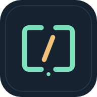

<div dir="rtl">

<p align="center">
  
</p>

<h1 align="center">Open NPV</h1>

<p align="center">
  <b>استخراج محلی کانفیگ از فایل‌های NPVT و NPVS — بدون آپلود، حتی آفلاین</b>
</p>

<p align="center">
  <a href="https://github.com/Kourosh242/open-NPV/actions/workflows/deploy.yml"></a>
  
  
</p>

<p align="center">
  سازنده: <a href="https://github.com/Kourosh242"><b>Kourosh242</b></a>
  ·
  <a href="https://kourosh242.github.io/open-NPV/">نسخهٔ آنلاین</a>
</p>

---

## این ابزار چه کار می‌کند؟

فایل خروجی برنامه‌های **NapsternetV / NPV Tunnel** را می‌گیرد، روی **دستگاه خودِ کاربر** بازگشایی می‌کند و کانفیگ‌های داخل آن را به شکل **لینک اشتراک** و **JSON کامل** تحویل می‌دهد تا در کلاینت‌های دیگر استفاده شوند.

هیچ سروری در کار نیست: رمزگشایی در Web Worker مرورگر انجام می‌شود. فایل، گذرواژه و خروجی هرگز آپلود نمی‌شوند.

## فهرست

- [ویژگی‌ها](#ویژگیها)
- [پشتیبانی قالب‌ها](#پشتیبانی-قالبها)
- [اجرای محلی](#اجرای-محلی)
- [حریم خصوصی و مرز اعتماد](#حریم-خصوصی-و-مرز-اعتماد)
- [معماری](#معماری)
- [تست‌ها](#تستها)
- [طراحی UI/UX](#طراحی-uiux)
- [پروانه](#پروانه)

## ویژگی‌ها

| | |
|---|---|
| 🔒 **کاملاً محلی** | پردازش در Web Worker؛ بدون آپلود، اکانت، تبلیغات یا آنالیتیکس |
| 📴 **آفلاین‌محور** | یک بار بارگذاری، بعداً بدون اینترنت؛ کش اتمی و نسخه‌بندی‌شده |
| 🔗 **لینک + JSON** | لینک اشتراک برای ایمپورت سریع، JSON کامل برای تنظیمات پیشرفته |
| 🎯 **تبدیل صادقانه** | هرجا تبدیل بدون اتلاف ممکن نباشد، لینک ناقص ساخته نمی‌شود |
| 🕶️ **نمایش امن** | رمزها و شناسه‌ها پیش‌فرض پوشیده‌اند؛ کپی/دانلود کامل و با اقدام کاربر |
| 🗂️ **چندفایلی** | تا ۲۰ فایل، صف پردازش، حذف تکی، فیلتر پروتکل و جست‌وجو |
| 📦 **خروجی متنوع** | TXT و JSON تکی، ZIP دسته‌ای همراه گزارش و هشدارها |
| 🌗 **پوسته** | تاریک/روشن، هماهنگ با سیستم، بدون پرش رنگ هنگام لود |
| ♿ **دسترس‌پذیر** | کیبورد، فوکوس مشخص، `aria-live`، احترام به کاهش انیمیشن |
| 🇮🇷 **فارسی و RTL** | فونت محلی وزیرمتن، اعداد فارسی در رابط، نام فایل‌ها دست‌نخورده |

## پشتیبانی قالب‌ها

| قالب | وضعیت |
|---|---|
| `NPVT1` (`.npvt`) | ✅ جدول‌های white-box، شمارندهٔ ۱۲۸ بیتی، حذف متادیتای قفل |
| `NPVS` v0/v1 — کلید برنامه | ✅ هر دو واریانت جدول KDK |
| `NPVS` v0/v1 — گذرواژه | ✅ PBKDF2-HMAC-SHA256 + ChaCha20-Poly1305 |
| `NPVS` v5 — کلید برنامه | ✅ شبکهٔ نسل ۲، HKDF، فیلدهای رمزنگاری‌شدهٔ NPF |
| `NPVS` v5 — گذرواژه | ✅ درخواست گذرواژه در رابط، بدون حدس رمز |
| `NPVO1` | ✅ JSON باز و نشانگرهای `npvs1:` |
| گیرنده‌محور (ECDH) | ❌ کلید خصوصی گیرنده لازم است |
| `npv2` / `npv4` / `npvtsub` | ❌ خارج از محدودهٔ این نسخه |

**پروتکل‌ها:** لینک اشتراک برای `VLESS`، `VMess`، `Trojan` و `Shadowsocks`. موارد دیگر (SSH، چند کاربر/سرور در یک outbound، افزونهٔ Shadowsocks، `sockopt`، `finalmask` و…) با هشدار صریح فقط به‌صورت JSON کامل حفظ می‌شوند.

> ⚠️ **JSON بازیابی‌شده ≠ قابل ایمپورت در هر کلاینت.** فیلدهای اختصاصی NPV ممکن است در برنامهٔ دیگر معادل نداشته باشند. لینک اشتراک هم DNS، مسیریابی و تنظیمات کامل Xray را حمل نمی‌کند.

## اجرای محلی

نیازمندی: **Node.js 20.19+** و npm.

```bash
npm ci
npm run verify     # تایپ‌چک + تست واحد + build + تست مرورگر
npm run preview    # http://localhost:3000
```

برای تست مرورگر، یک بار Chromium را نصب کنید:

```bash
npx playwright install chromium
```

| دستور | کار |
|---|---|
| `npm run typecheck` | بررسی تایپ TypeScript |
| `npm test` | تست‌های واحد و بردارهای مرجع |
| `npm run build` | ساخت `site/` + `source.zip` + Service Worker |
| `npm run test:browser` | تست واقعی مرورگر، آفلاین و حریم خصوصی |
| `npm run check` | تایپ‌چک + تست واحد + build |
| `npm run verify` | `check` + تست مرورگر |
| `npm run preview` | سرور محلی روی `0.0.0.0:3000` |

> `index.html` را با `file://` باز نکنید؛ Worker و Service Worker به وب‌سرور نیاز دارند.

## حریم خصوصی و مرز اعتماد

- هیچ `fetch` یا `XMLHttpRequest` برای ارسال فایل، رمز یا کانفیگ وجود ندارد. تنها درخواست‌ها، فایل‌های خود برنامه و نمونهٔ ساختگی هستند (تست مرورگر این را بررسی می‌کند).
- گذرواژه و نتایج در `localStorage`، `sessionStorage`، IndexedDB یا Cache API نوشته نمی‌شوند. **فقط انتخاب پوسته** ذخیره می‌شود.
- Worker بافر ورودی را صفر می‌کند و رابط پس از موفقیت یا پاک‌سازی آن را رها می‌کند. برای تلاش دوبارهٔ گذرواژه، فایل محافظت‌شده تا پاک‌سازی در RAM می‌ماند. **صفر کردن قطعی همهٔ کپی‌های رشته در JavaScript و سیستم‌عامل قابل تضمین نیست.**
- کلیپ‌بورد، فایل دانلودشده، افزونه‌های مرورگر و حافظهٔ دستگاه بیرون از کنترل برنامه‌اند. خروجی می‌تواند شامل UUID، رمز، آدرس سرور و کلید اتصال باشد.
- CSP اجرای اسکریپت خارجی و اتصال به origin دیگر را مسدود می‌کند.
- در NPVS، تگ‌های AEAD و AAD بررسی می‌شوند؛ شکست هر فیلد یعنی شکست کل فایل، نه خروجی ناقص. امضای سازنده مستقلاً تأیید نمی‌شود.
- **NPVT1 اصالت‌سنجی ندارد.** باز شدن فایل یعنی ساختار درست است، نه اینکه سرور سالم یا فایل معتبر است. هیچ تست اتصال یا پینگی انجام نمی‌شود.
- کش آفلاین با پاک کردن داده‌های سایت، حالت خصوصی یا کمبود فضا ممکن است از بین برود.

فقط فایل‌هایی را پردازش کنید که مالک آن‌ها هستید یا اجازهٔ بررسی دارید. گزارش آسیب‌پذیری: [`SECURITY.md`](SECURITY.md)

## معماری

```text
src/core/      پارسرها، رمزگشایی احرازشده، تبدیل URI
src/worker.ts  پردازش و ZIP خارج از نخ اصلی
src/app.ts     رابط فارسی، کلیپ‌بورد، دانلود، فیلتر
public/        پوستهٔ استاتیک، فونت و آیکون محلی، theme.js
vendor/        جدول‌های قالب با نسخه و چک‌سام ثابت
scripts/       build، سرور پیش‌نمایش، تولید جدول‌های قالب
tests/         نمونه‌های ساختگی، مولد Go، تست مرورگر
docs/          پژوهش قالب‌ها، راهنمای دیپلوی، یادداشت UI/UX
site/          خروجی قابل انتشار (در Git کامیت نمی‌شود)
```

بدون React، بدون CDN. کتابخانه‌ها: `@noble/ciphers`، `@noble/hashes`، `fflate` — همه داخل باندل محلی.

## تست‌ها

- **۲۷ تست واحد**: ۲۴ بردار نسل ۲ و ۱۲۰ بردار CTR از اجرای مستقل Go، شش پوش ساختگی، رمز اشتباه/گم‌شده، دستکاری AEAD، فایل ناقص، Base64 و JSON ناسالم، IPv6/REALITY/Host/SNI، حفظ JSON خام، مقاومت در برابر prototype pollution، نگه‌داری لینک ناقص داخلی به‌صورت JSON خام، رمزگشایی نشانگرهای npvs1، ماسک لینک سهروجن، تحمل توکن خالی در فهرست NPVT و ساختارشکنی Base64 با بیت‌های پایانی غیرصفر مطابق رفتار Go.
- **تست مرورگر (Playwright)**: رمزگشایی در Worker، نمونهٔ ساختگی، تلاش دوبارهٔ گذرواژه، نمایش/پنهان‌سازی، کپی و بازخورد دکمه، دانلود TXT/JSON/ZIP، جست‌وجو و فیلتر، حذف تکی، خطای فایل خراب، کش اتمی و محدود به مسیر، **بارگذاری و رمزگشایی آفلاین**، به‌روزرسانی با رضایت کاربر، پوستهٔ بدون پرش، چیدمان موبایل، و **نبود هرگونه درخواست خارجی یا آپلود**.

نمونه‌های داخل `tests/fixtures/` همگی **ساختگی** هستند (میزبان‌های `example.invalid` و کلیدهای نمایشی). هیچ فایل واقعی کاربر در مخزن نیست.

## طراحی UI/UX

تصمیم‌های طراحی، پژوهش و نتایج تست با مرورگر واقعی در [`docs/UI-UX.md`](docs/UI-UX.md) نوشته شده است. خلاصه: مسیر اصلی در سه قدم، بازخورد فوری برای هر اقدام، خطای قابل‌فهم به‌جای شکست خاموش، و حریم خصوصی به‌عنوان بخشی از رابط نه فقط یک شعار.

## پروانه

**AGPL-3.0-only** — چون از پیاده‌سازی فعلیِ AGPL پروژهٔ [Pantegnos](https://github.com/FrontierTM/Pantegnos) مشتق شده است. مخزن را با پروانهٔ MIT منتشر نکنید.

- متن کامل: [`LICENSE`](LICENSE)
- جزئیات و منابع: [`NOTICE`](NOTICE)
- نسخهٔ ثابت منبع و چک‌سام‌ها: `vendor/pantegnos/provenance.json`
- سورس همان build در سایت: `source.zip`

فونت [وزیرمتن](https://github.com/rastikerdar/vazirmatn) با پروانهٔ SIL OFL. پروژهٔ [IR-Toolbox](https://github.com/Kourosh242/IR-Toolbox) به‌عنوان مرجع تجربهٔ آفلاین بررسی شده است.

این پروژه مستقل است و وابستگی رسمی به NPV Tunnel یا NapsternetV ندارد.

</div>
